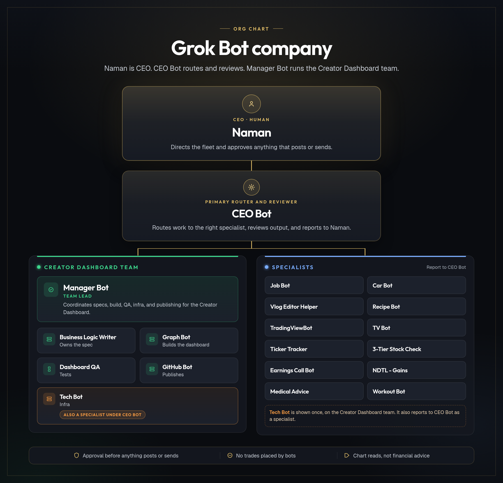

# Agentic workflow — Naman



Naman is CEO; CEO Bot routes and reviews; Manager Bot runs the Creator Dashboard team. [How to update this chart](docs/agentic-workflow/README.md).

I am a DevSecOps engineer with 6+ years of experience (USDOL tenants on AWS and Azure; CKAD). Day to day that means Kubernetes, CI/CD, Argo CD, Helm, and cloud automation.

This repository is a public portfolio of work I designed and operated with a fleet of Grok Bot agents: specialist bots for a TradingView indicator, YouTube ticker research, a localhost dashboard, Discord posting with audit guardrails, AWS labs, and an Android TV home launcher. I directed the builds and kept a standing rule that bots never place trades. Most of the source here was written by those agents under my direction.

The layout of that fleet is the org chart above. How it is organized, and how to update the image, is in [docs/agentic-workflow/](docs/agentic-workflow/README.md). Ticker Tracker's nightly fetch, the dashboard refresh, the PC data sync, and the on-demand backfill job are in [docs/agentic-workflow/pipelines.md](docs/agentic-workflow/pipelines.md).

Nothing in this repo is a trading recommendation. Secrets, webhook URLs, Terraform state, raw transcripts, personal holdings lists, signing keys, and generated certificates were removed or replaced with placeholders. Each project README has a section **What was removed and how to run it yourself** that lists what to fill in (environment variables, example config files, or generator scripts) if you clone the repo and want to run the project.

## Projects

| Project | What's in it | Tech | Agent |
| --- | --- | --- | --- |
| [NDTL Gains indicator](projects/ndtl-gains-indicator/) | TradingView Pine Script v6 indicator for opening range, premarket high/low, gap line, prior highs/lows, SMAs, premarket Fibonacci levels, and a multi-timeframe continuity table. v2.1 matches on regular- and extended-hours charts. | Pine Script v6, Python (fitting helpers) | NDTL - Gains |
| [Creator Calls dashboard](projects/creator-calls-dashboard/) | Local static dashboard (Ticker Timeline v2) that charts creator calls from `mentions.json`, scores 1-day / 5-day / to-date / vs-SPY returns, and runs insight tests. A v1 UI is kept alongside it. | HTML, CSS, JavaScript, Chart.js, Lightweight Charts, Python | Graph Bot |
| [YouTube ticker tracker](projects/youtube-ticker-tracker/) | Nightly pipeline that lists the latest long-form videos from a fixed set of trading YouTube channels, pulls transcripts, and merges per-video ticker / sentiment / price-talk extracts into `mentions.json`. | Python, yt-dlp, youtube_transcript_api, optional faster-whisper | Ticker Tracker |
| [Creator dashboard on k3s](projects/dashboard-k3s-ec2/) | Terraform + Helm (and optional Argo CD on the node) to host that dashboard on a single k3s EC2 instance behind an ALB, with S3 as the content source, hardened pods, and a publish path that strips holdings before upload. | Terraform, AWS (EC2, ALB, ACM, Route 53, S3, IAM, optional WAF), k3s, Helm, Argo CD | Tech Bot |
| [Discord posting guardrails](projects/discord-posting-guardrails/) | One allowlisted webhook poster with exclusive slot locks, SHA-256 receipts, and dry-run / check-only modes; a market-update pipeline; and read-only scanners for leaked webhook URLs, earnings-chart claims, and missing receipts. | Python 3, Discord webhooks, pytest | Manager Bot, TradingViewBot |
| [EKS LLM lab](projects/eks-llm-lab/) | Learning lab: a small EKS cluster with Terraform, Karpenter spot nodes, Argo CD GitOps, and an OpenTelemetry → Prometheus / Loki / Grafana path in front of a tiny llama.cpp model (optional vLLM on GPU). | Terraform, EKS, Karpenter, Argo CD, Helm, OpenTelemetry | Tech Bot |
| [NetScaler → CloudFront mTLS lab](projects/netscaler-cloudfront-mtls-lab/) | Learning simulation of replacing a NetScaler front door with AWS: ALB mTLS verify + CRL (recommended path), optional CloudFront viewer mTLS, and a free local nginx + mock-app tier. Fake CA and users only. | Terraform, ALB, CloudFront, Docker / nginx, OpenSSL | Tech Bot |
| [Android TV launcher](projects/android-tv-launcher/) | A leanback / home-screen Android TV launcher with a rotating landscape wallpaper dock for streaming apps. | Java, Android (minSdk 26, leanback) | TV Bot |

## Layout

```
README.md
.gitignore
docs/agentic-workflow/    # org chart (org.yaml + rendered PNG) and pipeline notes
projects/
  ndtl-gains-indicator/
  creator-calls-dashboard/
  youtube-ticker-tracker/
  dashboard-k3s-ec2/
  discord-posting-guardrails/
  eks-llm-lab/
  netscaler-cloudfront-mtls-lab/
  android-tv-launcher/
```

## What was removed (summary)

Details, and the exact files or commands you need to restore a working local setup, are in each project's **What was removed and how to run it yourself** section:

- [NDTL Gains](projects/ndtl-gains-indicator/README.md#what-was-removed-and-how-to-run-it-yourself) — large 1-minute CSVs and a few screenshots that showed a personal TradingView watchlist; the Pine source is included. No API keys required to use the indicator.
- [Creator Calls dashboard](projects/creator-calls-dashboard/README.md#what-was-removed-and-how-to-run-it-yourself) — full mention dumps replaced with a trimmed sample; personal holdings lists replaced with a neutral example placeholder; some UI screenshots withheld because they showed holdings markers. Increment 7 screenshots that do not identify holdings are under `screenshots/`. Regenerate data with `scripts/run_all.sh`.
- [YouTube ticker tracker](projects/youtube-ticker-tracker/README.md#what-was-removed-and-how-to-run-it-yourself) — raw transcripts and full mention history omitted. Run `fetch.py` and `analyze.py` with your own machine; no API key is required for yt-dlp.
- [k3s dashboard hosting](projects/dashboard-k3s-ec2/README.md#what-was-removed-and-how-to-run-it-yourself) — no Terraform state or filled `tfvars`. Copy `terraform.tfvars.example`, use your AWS profile, then `terraform apply`.
- [Discord posting guardrails](projects/discord-posting-guardrails/README.md#what-was-removed-and-how-to-run-it-yourself) — webhook URL, Discord IDs, and operational receipts replaced with placeholders. Copy `.env.example` and `poster/config.example.json`, create a Discord webhook, then dry-run.
- [EKS LLM lab](projects/eks-llm-lab/README.md#what-was-removed-and-how-to-run-it-yourself) — no state or account-specific `tfvars`. Copy `terraform.tfvars.example` and follow that project's README.
- [NetScaler mTLS lab](projects/netscaler-cloudfront-mtls-lab/README.md#what-was-removed-and-how-to-run-it-yourself) — generated CA keys and certs omitted. Run `scripts/make-pki.sh`, then the local or AWS tier.
- [Android TV launcher](projects/android-tv-launcher/README.md#what-was-removed-and-how-to-run-it-yourself) — debug keystore and APK omitted. The Gradle build uses the local Android debug keystore (`keytool` if you need to create one).

Do not commit secrets, `terraform.tfstate`, `*.pem` / `*.key`, or `*.keystore` files. The root `.gitignore` already lists these.
