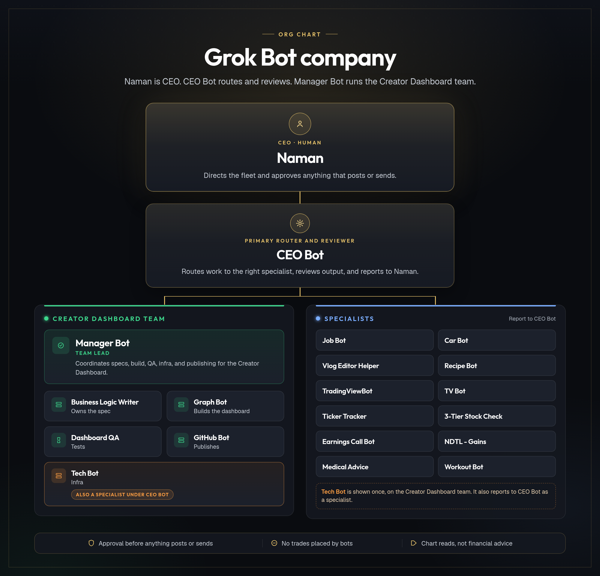
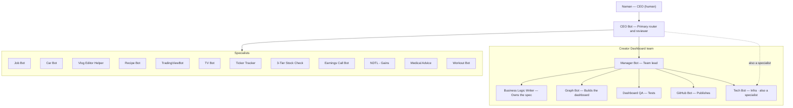

# Grok Bot company org chart

How the agent fleet in this portfolio is organized. Naman is CEO. **CEO Bot** is the primary router and reviewer. **Manager Bot** coordinates the Creator Dashboard team. Specialist bots report to CEO Bot. **Tech Bot** is shown once: it is on the Creator Dashboard team (infra) and also reports to CEO Bot as a specialist.
How Ticker Tracker's nightly fetch, the dashboard refresh, the PC data sync, and the on-demand backfill job fit together is in [pipelines.md](pipelines.md).



## How to update the chart

1. Edit the source file: [`org.yaml`](org.yaml).
2. From this folder, run:

   ```bash
   python3 render.py
   ```

   That regenerates `org-chart.html`, this README's Mermaid block, and the canonical image `org-chart.png`.

Do not hand-edit `org-chart.html` or the Mermaid block; they are generated from `org.yaml`. The PNG is the only canonical image used in the top-level README.

`render.py` needs Python 3, PyYAML, Playwright, and a Chromium/Chrome binary, plus the Outfit and Geist font files already in this folder.

## Mermaid (renders on GitHub)

<!-- ORG_MERMAID_START -->

<!-- ORG_MERMAID_END -->

No secrets, webhook URLs, account details, holdings, or machine paths are in these files.
