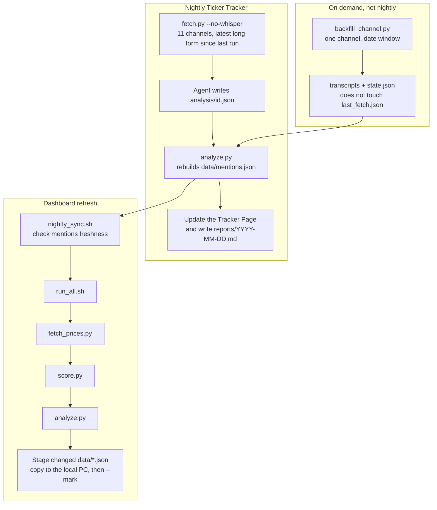

# Ticker Tracker and dashboard pipelines

How Ticker Tracker and the Creator Calls dashboard run together. Times below are in Eastern Time (America/New_York). They come from Ticker Tracker's nightly reports and `data/last_fetch.json`, not from a cron expression in this repo.

## Nightly job (Ticker Tracker)

Ticker Tracker watches a fixed list of **11** trading YouTube channels, defined near the top of `fetch.py` as `CHANNELS`:

StockedUp, ThePlainBagel, DumbMoneyLive, futurenvesting, StockswithJosh, TradeBrigade, JosephCarlsonAfterHours, OptionsWithRyan, wickedstocksofficial, amitinvesting, and joinschoolofgains (School of Gains).

Recent nightly reports record the fetch starting **around 1 AM ET**. In early November 2026 the recorded start was about 1:02–1:05 AM ET; on November 11–14 it was 1:19–1:25 AM ET. The command used on those nights is:

```bash
python3 fetch.py --no-whisper
```

`fetch.py` only considers each channel's **latest long-form** videos (Shorts and currently-live or upcoming streams are skipped; finished streams are kept). By default it takes `--max 1` per channel and stops at the first video it has already seen or that is older than the since-last-run cutoff (the `run` date in `data/last_fetch.json`). It does not backfill older videos. A brand-new channel gets only its single newest eligible long-form video on the first run.

Transcripts are tried in this order: a local `data/pc_subs/` caption file if one was staged (when YouTube blocked downloads), then `youtube_transcript_api`, then yt-dlp captions, then optional `faster_whisper` (nightly runs pass `--no-whisper`, so that last step is skipped).

After the fetch, analysis is agent-driven:

1. `python3 analyze.py --pending` lists new video ids.
2. For each one, the nightly agent reads the transcript (`python3 compact.py <id>`) and writes `analysis/<id>.json` (ticker, sentiment, price talk, summary).
3. `python3 analyze.py` merges those files into `data/mentions.json` and marks videos analyzed in `state.json`.
4. The agent refreshes the Trading YouTube Ticker Tracker Page from that data, runs `python3 errors_summary.py`, and writes `reports/YYYY-MM-DD.md`.

Details, including the PC captions fallback, are in [projects/youtube-ticker-tracker/README.md](../../projects/youtube-ticker-tracker/README.md).

## Dashboard refresh and PC sync

Once `mentions.json` is current, the dashboard refresh does not need a bot. `scripts/run_all.sh` in the Creator Calls dashboard runs, in order:

1. `python3 scripts/fetch_prices.py` — daily bars, sectors, and earnings dates into `data/prices.json` (Yahoo / yfinance; reuses the cache unless `--refresh`).
2. `python3 scripts/score.py` — next-session returns, hits, flips, and related fields into `data/scores.json`. No network.
3. `python3 scripts/analyze.py` — Insights tests into `data/insights.json`. No network.

`scripts/nightly_sync.sh` is the wrapper used for Naman's local (Windows) copy:

- Warns if the mentions file looks stale (mtime older than 26 hours).
- Runs `run_all.sh` and writes `.last_run.log`.
- Copies any `data/*.json` whose content changed into `.sync/`, so those files can be copied onto the PC.
- After every copy succeeds, `nightly_sync.sh --mark` records their hashes and clears the staging folder.

This copy of the script takes the mentions file from `MENTIONS_JSON` if set, otherwise from `../youtube-ticker-tracker/data/mentions.json`. The page itself is only recopied when the UI changes; a nightly data refresh is enough to pick up new calls after a browser reload.

There is no clock time for the sync in the scripts. It is meant to run after the ticker-tracker mentions file has been updated.

## Backfill job

Nightly `fetch.py` never walks older videos. For a one-time (re-runnable) date-window backfill of a **single** channel, use `backfill_channel.py`. It reuses helpers from `fetch.py`. It does **not** write `data/last_fetch.json` or `data/prev_fetch.json`, so a backfill cannot clobber the nightly cutoff. New video ids are appended to `state.json`; existing state rows are left unchanged unless a prior backfill skip is successfully retried.

```bash
python3 backfill_channel.py --channel joinschoolofgains \
    --start 2026-10-26 --end 2026-11-10 --no-whisper
```

Those defaults match the November 10 School of Gains backfill the script was written for. It lists the channel's Videos and Streams tabs (newest first), keeps long-form uploads inside the date window, and writes transcripts and metadata the same way `fetch.py` does. It stops walking a tab once it hits a video older than `--start`. A JSON report is written under `data/` when it finishes. After a backfill, run the dashboard `run_all.sh` path if you want scores and insights to include the new rows.

## Flow


