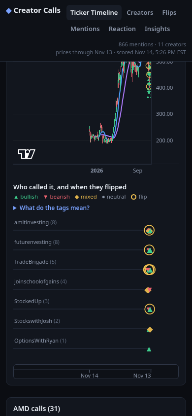
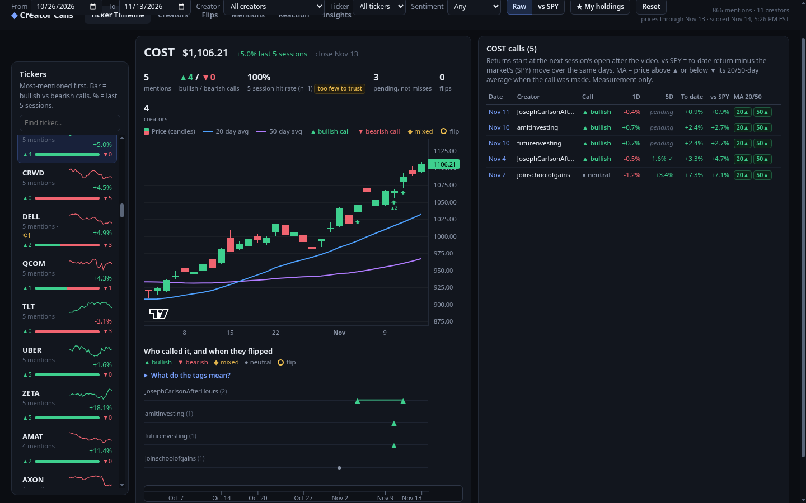
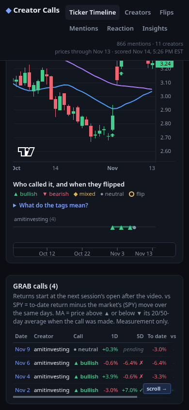
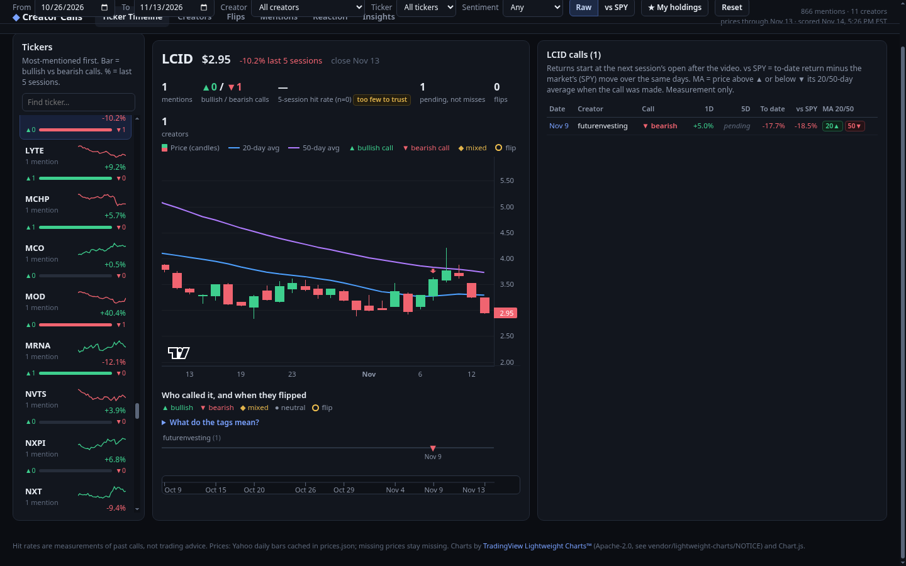
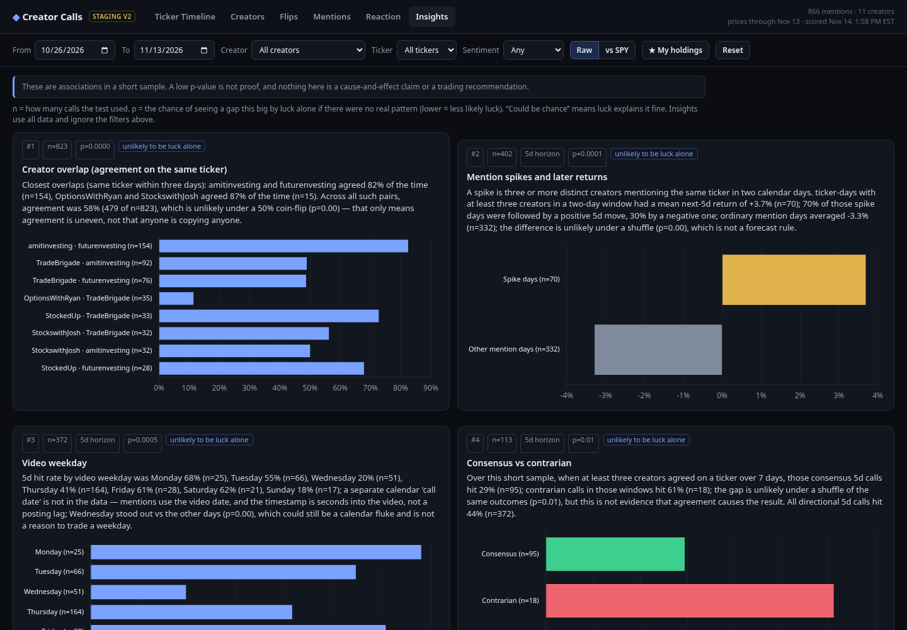

# Creator Calls — Ticker Timeline

A local, offline-friendly view of Ticker Tracker's `mentions.json`, built with the **Graph Bot** Grok Bot agent under Naman's direction (Business Logic Writer owns the spec; Dashboard QA tests; Tech Bot does infra; GitHub Bot publishes; Manager Bot coordinates). The main page is a ticker timeline: a ticker list, a price chart with 20-day and 50-day averages and creator call markers (▲/▼, gold rings for flips), a row per creator under the chart, and a calls table with 1-day, 5-day, to-date, and vs-SPY returns. Other tabs cover creators, flips, mentions, reaction, and Insights.

This copy is **Increment 7**, the version that was live when these files were staged. A freshness banner (see `js/freshness.js`) warns if `scores.json` is more than 26 hours old.

This is not a replacement for the **Trading YouTube Ticker Tracker** Page. That Page lives in Cursor and is only refreshed when the nightly job edits it. This dashboard is a static site you run on localhost: it **fetches the JSON in the browser on every load**, so new data shows up after a refresh. It does not list "latest video per channel."

The previous dashboard is kept at `v1/` (open http://localhost:8000/v1/ after starting the server from this folder). How the nightly ticker fetch, this refresh, the PC data sync, and the backfill job fit together is in [../../docs/agentic-workflow/pipelines.md](../../docs/agentic-workflow/pipelines.md).

## Screenshots (Increment 7)

These are current shots of the live Increment 7 UI. Desktop timeline screenshots that showed a star next to a holdings ticker, or a "held" tag, were left out.



AMD on the Ticker Timeline, mobile: the price chart, the per-creator flip strip, and the start of the calls table.



COST on the Ticker Timeline, desktop. The ticker list is scrolled to names that are not in the default holdings set, so no holdings stars appear.



GRAB on the Ticker Timeline, mobile, including the calls table.



LCID on the Ticker Timeline, desktop, zoomed in. Same rule: the visible ticker list has no holdings stars.



The Insights tab (slightly earlier capture than the Increment 7 timeline shots; it still has a "STAGING V2" badge). No holdings markers are in view.

## Run

```bash
cd creator-calls-dashboard
./serve.sh
```

Then open http://localhost:8000/

Or, from this folder: `python3 -m http.server 8000`

Deep links: `#tab=timeline&t=AMD`, `#tab=creators`, `#tab=flips`, `#tab=mentions`, `#tab=reaction`, `#tab=insights`.

## Data

`js/config.js` sets the JSON paths (defaults: `./data/mentions.json`, `./data/scores.json`, `./data/insights.json`, `./data/prices.json`).

Put `mentions.json`, `scores.json`, `insights.json`, and `prices.json` in `./data/`, or point the paths in `js/config.js` at another path or URL. The YouTube ticker-tracker pipeline can produce `mentions.json`. A nightly refresh can copy those files into `./data/`.

## Refresh scores and insights

These scripts do not need a bot. They read the local mentions file and (for prices) Yahoo / yfinance, then write JSON under `./data/`.

```bash
./scripts/run_all.sh
```

Or step by step:

1. `python3 scripts/fetch_prices.py` — daily bars, sectors, and earnings dates into `data/prices.json` (reuses the cache unless `--refresh`).
2. `python3 scripts/score.py` — next-session returns, hits, flips, reaction, to-date returns, SMA-20/50 at the call, and flip tags into `data/scores.json`. No network.
3. `python3 scripts/analyze.py` — the Insights tests into `data/insights.json`. No network.

Scoring starts returns at the **next trading day's open** after the video date, because upload time is unknown. Same-day moves are not counted. A bullish call hits when that forward return is positive; a bearish call hits when it is negative. Calls without enough future bars are pending, not misses.

Flip tags use the rule in `scripts/flip_config.json`: **ahead of the move** if the 5 sessions after the flip went the new way; **after the move** if the stock had already moved that way in the 5 sessions before and then didn't follow through; otherwise **no follow-through** or **pending**. Rerun `./scripts/run_all.sh` after editing that file.

Insights are sorted by evidence strength (binomial / permutation / bootstrap vs a 50% or group baseline). Every card shows **n**. Cards with n&lt;10 are flagged **too few calls to trust**. Non-significant results say **could be chance**. Nothing in Insights is a cause-and-effect claim or a trade recommendation.

`scripts/nightly_sync.sh` runs `run_all.sh`, then stages changed `data/*.json` files so they can be copied to a local machine. After the copy, `nightly_sync.sh --mark` records the hashes. The mentions path defaults to the sibling ticker-tracker data file; override it with `MENTIONS_JSON`. The page itself does not need to be recopied unless the UI changes.

## Holdings

You can list ticker symbols in `js/config.js` under `holdings` to highlight and isolate them with the **My holdings** filter. This copy ships with `["AAPL"]` as a neutral example placeholder (the same placeholder is the fallback in `js/v2.js` and in `v1/js/app.js`). Replace it with your own list, or use `[]`.

## Vendored

- `vendor/lightweight-charts` — TradingView Lightweight Charts™ v5.3.0, Apache-2.0 (LICENSE + NOTICE kept; attribution logo left on in the chart)
- `vendor/chart.umd.min.js` — Chart.js


## Tech stack

- HTML, CSS, and vanilla JavaScript (`index.html`, `css/v2.css`, `js/v2.js`, `js/config.js`, `js/freshness.js`)
- TradingView Lightweight Charts v5.3.0 and Chart.js (vendored)
- Python 3 scoring and insights scripts (`scripts/fetch_prices.py`, `score.py`, `analyze.py`) using yfinance / Yahoo for daily bars
- `serve.sh` or `python3 -m http.server` for local viewing

A prior version of the UI is kept under `v1/`.


## What was removed and how to run it yourself

**Removed or redacted:**

- The full `mentions.json` / `scores.json` / `prices.json` dumps (hundreds of videos, a ~10 MB price cache). This copy ships a **trimmed sample** under `data/` (and the same mentions sample under `../youtube-ticker-tracker/examples/`) so the page can load. Insight cards are empty in the sample; they were computed on the full set.
- Personal **holdings** ticker lists in `js/config.js`, `js/v2.js`, and `v1/js/app.js`, replaced with a neutral `["AAPL"]` example and a comment. The "My holdings" filter still works if you add your own symbols.
- Desktop timeline, Creators, and Flips screenshots that showed holdings stars or a "held" tag on personal tickers. The screenshots under `screenshots/` do not identify those tickers. (The COST and LCID desktop shots are slightly cropped at the top bar; they were kept because the visible ticker list has no holdings stars.)
- Absolute machine paths in `scripts/nightly_sync.sh` (replaced with a relative default and a `MENTIONS_JSON` override).
- Nightly sync logs and the production Cursor Page identifier.

**To run the dashboard with the sample:**

```bash
cd projects/creator-calls-dashboard
./serve.sh          # or: python3 -m http.server 8000
```

Open http://localhost:8000/

**To rebuild data from a mentions file** (your own or a larger extract from the ticker-tracker pipeline):

```bash
pip install -r requirements.txt
# put mentions.json in data/ (or set the path in js/config.js)
./scripts/run_all.sh
# which runs:
#   python3 scripts/fetch_prices.py   # Yahoo / yfinance; needs network
#   python3 scripts/score.py          # local
#   python3 scripts/analyze.py        # local, writes insights.json
```

No API keys are required for Yahoo/yfinance in the current scripts. Do not commit a holdings list you would not want public; `../dashboard-k3s-ec2/scripts/push-data.sh` strips holdings before a public upload.
