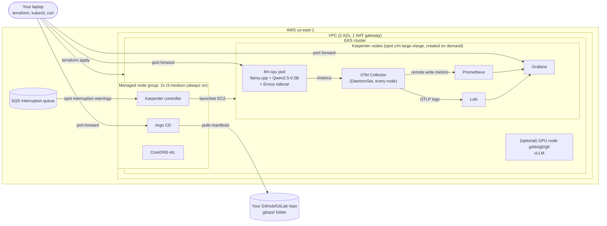

# EKS LLM Lab: a tiny open-source LLM on EKS (Terraform + Karpenter + Argo CD + OpenTelemetry)

Built with the **Tech Bot** Grok Bot agent under Naman's direction.

A hands-on, personal learning project. You'll build a small EKS cluster with Terraform, let **Karpenter**
add a cheap **spot** node when the model needs one, have **Argo CD** deploy everything from Git, and
watch it all in **Grafana** through an **OpenTelemetry Collector**. No paid Splunk account needed.

> **Cost warning:** it costs about **$0.38/hour** (roughly **$276/month** if you forget it) for the default CPU setup.
> See [COST.md](COST.md). **Run the teardown when you're done for the day.**

---

## 1. What you'll build



**The flow in plain words:**
1. Terraform creates the network, the cluster, a small always-on node group, Karpenter, and Argo CD.
2. Terraform also creates one Argo CD "root" app that points at the `gitops/apps` folder in **your** Git repo.
3. Argo CD reads that folder and installs: Prometheus + Grafana, Loki, the OTel Collector, the dashboard, and the model server.
4. The model server asks for 3 vCPU. The small system nodes only have 2, so the pod waits ("Pending").
   Karpenter sees this and launches a spot `c`/`m` xlarge instance within a minute or two. The pod starts there.
5. The OTel Collector on each node gathers CPU/memory stats, container logs, and the model server's metrics, then
   sends metrics to Prometheus and logs to Loki. Grafana shows them.

## 2. Repo layout

```
terraform/                      # everything AWS + bootstrap
  versions.tf providers.tf variables.tf outputs.tf
  vpc.tf eks.tf karpenter.tf argocd.tf
  terraform.tfvars.example      # copy to terraform.tfvars (git-ignored)
  backend.tf.example            # optional S3 remote state
  charts/karpenter-nodepools/   # EC2NodeClass + CPU spot NodePool (+ GPU NodePool if enabled)
  charts/argocd-bootstrap/      # the root "app-of-apps" Application
gitops/
  apps/                         # Helm chart: one Argo CD Application per component
  workloads/llm-cpu/            # llama.cpp + Envoy (default)
  workloads/llm-gpu/            # vLLM on GPU (only when enable_gpu_nodepool=true)
  workloads/dashboards/         # Grafana dashboard as a ConfigMap
COST.md  RESUME.md
```

## 3. Why llama.cpp server + Qwen2.5-0.5B-Instruct (Q4_K_M)?

I compared Ollama, llama.cpp server, and vLLM CPU:

| Option | Runs well on CPU? | OpenAI-style API | Prometheus metrics | Verdict |
|---|---|---|---|---|
| **llama.cpp `llama-server`** | Yes. Built for CPU, tiny quantized GGUF files | Yes (`/v1/chat/completions`) | **Yes, `--metrics`** (tokens/sec, tokens processed, requests in flight) | **Chosen** |
| Ollama | Yes (it runs llama.cpp under the hood) | Yes | **No** native `/metrics` endpoint | Easy, but you can't monitor it well |
| vLLM CPU | Works, but heavy image, slow builds, picky about CPU flags | Yes | Yes | Best on **GPU**, so it's the GPU variant |

Model: **Qwen2.5-0.5B-Instruct, 4-bit (≈400 MB)**. It's small, permissively licensed (Apache-2.0), good at following
instructions for its size, and on a 4-vCPU node it generates tokens fast enough to feel interactive.
llama.cpp doesn't expose per-request latency, so an **Envoy sidecar** sits in front of it and gives a real latency histogram.

## 4. Prerequisites

- An **AWS account** you're allowed to spend about $1–10 in, and credentials that work in your terminal
  (`aws sso login --profile lab` then `export AWS_PROFILE=lab`, or any normal AWS CLI setup).
  Check with `aws sts get-caller-identity`. **Nothing in this repo contains credentials**; Terraform uses the default AWS credential chain.
  Your identity needs admin-level rights (it creates a VPC, IAM roles, EKS, SQS, and EventBridge).
- Tools: `terraform` ≥ 1.6, `aws` CLI v2, `kubectl`, `helm` (optional), `git`, `curl`, `jq`.
- **Your own Git repo** (GitHub/GitLab). Argo CD runs *inside* the cluster and pulls from Git, so it can't read your laptop.
  A public repo is easiest. For a private repo, add it in Argo CD with a read-only deploy token (`argocd repo add ...`). Don't commit the token.
- A region. Default is `us-east-1`.

## 5. Step by step

### 5.1 Push this repo to your Git host
```bash
cd eks-llm-lab
git remote add origin https://github.com/<you>/eks-llm-lab.git
git push -u origin main
```

### 5.2 Configure variables
```bash
cd terraform
cp terraform.tfvars.example terraform.tfvars
# edit: gitops_repo_url = "https://github.com/<you>/eks-llm-lab.git"
```

### 5.3 Create everything (~15–20 min)
```bash
terraform init      # downloads providers + modules
terraform plan      # READ IT: shows what will be created (~70 resources)
terraform apply     # type "yes"
```
Terraform gives you plain-language checkpoints. `plan` is a dry run, and nothing costs money until `apply`.

### 5.4 Connect kubectl
```bash
$(terraform output -raw configure_kubectl)
kubectl get nodes                 # 2 system nodes at first
kubectl get nodeclaims -w         # watch Karpenter add a spot node for the model (Ctrl-C to stop)
```

### 5.5 Open Argo CD
```bash
kubectl -n argocd get secret argocd-initial-admin-secret -o jsonpath='{.data.password}' | base64 -d; echo
kubectl -n argocd port-forward svc/argocd-server 8080:80
# open http://localhost:8080  (user: admin). All apps should become Synced/Healthy within ~5-10 min.
```

### 5.6 Open Grafana
```bash
kubectl -n monitoring get secret kube-prometheus-stack-grafana -o jsonpath='{.data.admin-password}' | base64 -d; echo
kubectl -n monitoring port-forward svc/kube-prometheus-stack-grafana 3000:80
# open http://localhost:3000 (user: admin) -> Dashboards -> "EKS LLM Lab"
# Logs: Explore -> Loki -> {k8s_namespace_name="llm"}
```

### 5.7 Send a test prompt
```bash
kubectl -n llm port-forward svc/llm-cpu 8000:80
curl -s http://localhost:8000/v1/chat/completions -H 'Content-Type: application/json' -d '{
  "model": "qwen2.5-0.5b-instruct",
  "messages": [{"role":"user","content":"Explain Kubernetes in one sentence."}],
  "max_tokens": 100
}' | jq -r '.choices[0].message.content, .timings'
```
Run a small loop to make the dashboard interesting:
```bash
for i in $(seq 1 30); do curl -s -o /dev/null http://localhost:8000/v1/chat/completions \
  -H 'Content-Type: application/json' -d '{"messages":[{"role":"user","content":"Write a haiku about spot instances"}],"max_tokens":64}'; done
```

### 5.8 (Optional) GPU variant with vLLM
Set `enable_gpu_nodepool = true` in `terraform.tfvars` and run `terraform apply`. This adds a tainted GPU NodePool
(g4dn/g5/g6 xlarge) and tells Argo CD to deploy the NVIDIA device plugin and `llm-gpu` (vLLM, fp16 Qwen2.5-0.5B).
First start takes ~5–10 min (big image + model download). Test with `kubectl -n llm port-forward svc/llm-gpu 8001:80` and the same curl on port 8001.
Your account may need a **G/VT instance vCPU quota** increase first (Service Quotas → EC2 → "Running On-Demand G and VT instances" and "All G and VT Spot Instance Requests"; new accounts are often 0).
Set it back to `false` and apply again to remove the GPU parts.

## 6. Tear down cleanly (do this every time)

The important rule: **remove things Karpenter and Kubernetes created *before* Terraform destroys the cluster.**
Terraform doesn't know about Karpenter's EC2 instances or any load balancers made by Services, so they could be left running and blocking VPC deletion.

```bash
# 1. Stop Argo CD from recreating things, then delete the apps (finalizers clean up their resources)
kubectl -n argocd patch application root --type merge -p '{"spec":{"syncPolicy":null}}'
kubectl -n argocd delete applications --all --wait=true

# 2. Make sure no LoadBalancer Services remain (this lab creates none by default)
kubectl get svc -A | grep LoadBalancer || echo "no load balancers"

# 3. Let Karpenter remove its nodes (deleting NodePools drains + terminates their EC2 instances)
kubectl delete nodepools --all
kubectl get nodeclaims -w        # wait until empty, then Ctrl-C

# 4. Destroy everything Terraform made
cd terraform && terraform destroy
```
Finally, double-check in the console (EC2 → Instances, filter tag `karpenter.sh/nodepool`; EC2 → Load Balancers; VPC → NAT gateways)
that nothing is left. If an instance was orphaned, terminate it by hand, then rerun `terraform destroy`.

## 7. What each piece does and why (the learning part)

**Terraform**: Infrastructure as code. You describe *what you want* in `.tf` files, `plan` shows the difference between that and
reality, and `apply` makes it so. It records what it created in a **state file** (`terraform.tfstate`). Never commit that file; it's in `.gitignore`.
- *Providers* (`versions.tf`) are plugins that talk to an API: `aws` for AWS and `helm` for installing charts into the new cluster.
- *Modules* (`terraform-aws-modules/vpc`, `.../eks`) are reusable bundles of resources, like Helm charts for AWS.
  Using them saves you from writing ~100 resources by hand.
- *Variables* (`variables.tf`) are the knobs. *Outputs* (`outputs.tf`) are the useful values printed after apply.
- *State backend*: by default the state is a local file. For teams, or to avoid losing it, use S3: `cp backend.tf.example backend.tf`,
  create the bucket (versioning on), then `terraform init -migrate-state`. `use_lockfile = true` stops two people applying at once.

**VPC** (`vpc.tf`): your private network. Nodes sit in *private* subnets with no public IPs. To download images and the model,
they go out through **one NAT gateway** in a public subnet. One NAT instead of one per AZ saves ~$33/month per gateway, but
if that AZ goes down, outbound internet stops. That's fine for a lab, not for production.

**EKS** (`eks.tf`): AWS runs the Kubernetes control plane for $0.10/hr. Addons: VPC CNI (pod IPs come from the VPC), CoreDNS, kube-proxy,
and the **Pod Identity agent**, which lets pods get AWS permissions without keys. `enable_cluster_creator_admin_permissions` makes *your*
IAM identity cluster-admin through an EKS access entry, so no aws-auth ConfigMap editing is needed.

**Managed node group "system"**: 2× t3.medium that are always on. Karpenter can't run on nodes it manages itself (chicken-and-egg), so it
and Argo CD live here.

**Karpenter** (`karpenter.tf`, `charts/karpenter-nodepools`): You already know it. What's new here is the Terraform side:
the `karpenter` submodule creates the controller IAM role (Pod Identity), the **node IAM role** + access entry, and the
**SQS queue + EventBridge rules** that deliver the 2-minute spot interruption warnings, so Karpenter can drain a node gracefully.
- `cpu-spot` NodePool: `c`/`m` families, `large`/`xlarge`, generation > 5, **spot preferred with on-demand fallback**, capped at 16 vCPU, consolidates empty or underused nodes after 2 minutes.
- `gpu` NodePool (off by default): g4dn/g5/g6 xlarge, **tainted** `nvidia.com/gpu` so only GPU pods land there.
- NodePools are installed as a tiny local Helm chart so Terraform can apply them without the kubectl provider (avoids CRD-at-plan-time problems).

**Argo CD** (`argocd.tf`, `gitops/apps`): installed by Terraform with Helm, then given **one** root Application (app-of-apps).
The root points at `gitops/apps`, a Helm chart whose templates are child Applications. Terraform passes `repoURL` and
`gpu.enabled` down, so one Terraform variable controls both the GPU NodePool and the GPU workloads. From now on, **change things by git push**, not kubectl.
Sync waves install monitoring (`-2`), then the collector (`-1`), then the apps.

**Model server** (`gitops/workloads/llm-cpu`): an init container downloads the GGUF file, `llama-server` serves an OpenAI-compatible API
on :8081 with `--metrics`, and Envoy on :8080 proxies to it and records latency. The 3 vCPU request is deliberate: it doesn't fit on system
nodes, so it demonstrates Karpenter scaling. `nodeSelector: workload-type: cpu` pins it to the Karpenter pool.

**OpenTelemetry Collector** (DaemonSet): You know Splunk OTel. This is the upstream "contrib" distribution with the same concepts:
- receivers: `kubeletstats` (node/pod CPU and memory), `filelog` (container logs from `/var/log/pods`), `prometheus` (scrapes llama.cpp,
  Envoy, and vLLM pods on the same node), `otlp` (for apps that push).
- processors: `k8sattributes` (adds pod/namespace/node labels), `memory_limiter`, `batch`.
- exporters: `prometheusremotewrite` → Prometheus, `otlp_http` → Loki.

**kube-prometheus-stack**: Prometheus (with the remote-write receiver turned on), Grafana, node-exporter, and kube-state-metrics (node count,
Karpenter labels). It also scrapes kubelet/cAdvisor itself, which the dashboard uses for pod CPU/memory. Storage is `emptyDir`, so data is
lost if the pod moves. That's fine for a lab and means there are no EBS volumes to forget.

**Loki**: Single-binary log store on local disk, so the "logs" half of OTel has somewhere to go for free.

**Grafana dashboard "EKS LLM Lab"**: node count (total vs Karpenter), request rate, p50/p95 latency (Envoy), tokens/sec (llama.cpp; vLLM when GPU is on),
CPU and memory per pod, and node CPU.

### Swap the exporter to Splunk Observability Cloud
When you have a Splunk Observability org, edit `gitops/apps/templates/otel-collector.yaml`:
```yaml
exporters:
  signalfx:
    access_token: ${env:SPLUNK_ACCESS_TOKEN}
    realm: us1
  otlp_http/splunk:   # traces/logs via OTLP
    endpoint: https://ingest.us1.signalfx.com/v2/trace/otlp
    headers: { X-SF-Token: "${env:SPLUNK_ACCESS_TOKEN}" }
service:
  pipelines:
    metrics: { exporters: [signalfx] }
```
Put the token in a Kubernetes Secret (created by hand, or with External Secrets), **not in Git**, and expose it with the chart's
`extraEnvs` + `valueFrom.secretKeyRef`. Splunk Platform logs go to a `splunk_hec` exporter.
You can also swap the whole chart for Splunk's `splunk-otel-collector` Helm chart. The receivers are the same, with Splunk defaults pre-wired.

## 8. Troubleshooting
- `llm-cpu` Pending for >5 min: `kubectl -n kube-system logs deploy/karpenter`. Usually it's a spot capacity issue or vCPU quota; the on-demand fallback should still kick in.
- Argo CD app "Unknown"/"ComparisonError": the repo URL is wrong or the repo is private. Check `gitops_repo_url`.
- Empty llama.cpp panels: send some prompts first, then check `kubectl -n observability logs ds/otel-collector-agent`.
- Images in `llm-cpu` use floating/pinned tags noted in comments. Pin `ghcr.io/ggml-org/llama.cpp:server` to a `server-bNNNN` tag once it works.


## What was removed and how to run it yourself

**Removed (security):**
- Terraform state and `.terraform/` caches (gitignored). Do not commit state; it can include cluster endpoints and ARNs.
- A filled `terraform.tfvars`. Use `terraform/terraform.tfvars.example`.
- Any real AWS account numbers. Example ARNs in GitOps values already use a clearly fake repeated-digit account or the documentation account. Certificate and trust-store ARNs in `gitops/apps/values.yaml` are placeholders (`CHANGE-ME` for the origin-verify secret).

**What you must supply:**

1. A personal/sandbox AWS account and a local AWS credential profile (no keys in the repo).
2. Copy and edit the example vars, then follow the step-by-step in this README (Terraform apply, then point Argo CD at your Git fork of `gitops/`):

```bash
cp terraform/terraform.tfvars.example terraform/terraform.tfvars
# set region, name, and any feature flags documented in the example
cd terraform && terraform init && terraform plan && terraform apply
```

3. Replace placeholder ACM / trust-store ARNs and `originVerifySecret` in `gitops/apps/values.yaml` with values from your apply outputs or AWS console, in your own clone — do not commit real secrets. See [COST.md](COST.md) and tear the lab down when you are done.
