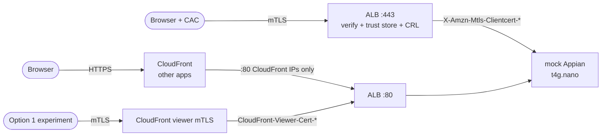

# NetScaler -> CloudFront mTLS migration lab (simulation)

Built with the **Tech Bot** Grok Bot agent under Naman's direction.

A self-run **learning simulation**: replace a Citrix NetScaler front door with AWS, where one app (a mock
"Appian") logs users in with **CAC/PIV-style client certificates (mTLS)** and every other app sits on CloudFront.
All names, CAs and hostnames here are fake (`Example Agency`, `Test User One`, `*.example.com`).

> **Cost:** local tier is free. AWS tier is about **$0.055/hour (~$1.30/day)**. See [COST.md](COST.md). **Run `terraform destroy` when done.**

Running this on your existing EKS lab? See **[docs/eks-cloudfront-step-by-step.md](docs/eks-cloudfront-step-by-step.md)**.

Start with **[docs/options-comparison.md](docs/options-comparison.md)**. It has the research (with AWS sources) and the recommendation.

## 0. Why this matters (short version)
NetScaler today probably: terminates TLS, asks for the CAC, checks the chain + CRL/OCSP, then injects headers
(subject/serial/PEM) that Appian trusts to pick the user. On AWS you have three ways to do the same:

1. **CloudFront viewer mTLS:** cert checked at the edge. Revocation is OCSP only (May 2026) or a do-it-yourself deny-list. No CRL file.
2. **ALB mTLS verify:** cert checked by an ALB with a trust store **and a CRL**. Appian's DNS points at the ALB. Everything else stays on CloudFront. **(recommended for now)**
3. **NLB TCP passthrough:** AWS never decrypts. Your ingress/app does mTLS itself.



Kubernetes analogy: the ALB with mTLS verify works like an ingress-nginx `auth-tls-verify-client: on` + `auth-tls-secret`
setup that runs outside the cluster. The trust store plays the role of the CA secret, and the injected headers work like `ssl-client-subject-dn`.

## 1. Repo map
```
scripts/make-pki.sh        fake Root CA -> Issuing CA -> 2 client certs (1 revoked) + CRLs + server cert
local/                     FREE tier: docker compose = nginx (mTLS+CRL, ALB-style headers) + mock Appian
terraform/                 AWS tier: VPC, ALB mTLS verify + trust store + CRL, EC2 backend, CloudFront (+ optional viewer mTLS)
tests/run-tests.sh         valid=200 / no cert=reject / revoked=reject  (local | aws | cloudfront-mtls)
tests/smoke-no-docker.sh   same checks with only openssl+python (no docker needed)
docs/                      options comparison, NetScaler discovery checklist, cutover plan, rollback checklist
```

## 2. Build the fake PKI (both tiers)
```bash
./scripts/make-pki.sh            # writes ./pki (gitignored). LAB_DOMAIN=... to change the fake hostname
openssl x509 -in pki/client-valid.pem -noout -subject -serial -ext subjectAltName
```
Test User Two's cert is revoked in `pki/int-ca.crl.pem`. The client certs carry a UPN in the SAN (otherName), like PIV cards do.

## 3. Local tier (free)
```bash
cd local && docker compose up -d --build && cd ..
tests/run-tests.sh local
IDENTITY_FIELD=serial docker compose -f local/docker-compose.yml up -d   # try subject | serial | dn | upn
docker compose -f local/docker-compose.yml down
```
No Docker? `tests/smoke-no-docker.sh` proves the same TLS/CRL behaviour with `openssl s_server`, and runs the app with python.

Things to try: comment out `ssl_crl` in `local/nginx/nginx.conf` and watch the revoked cert get **in**. Then send a forged
`X-Amzn-Mtls-Clientcert-Subject` header and see that nginx overwrites it.

## 4. AWS tier

### AWS safety rules (read first)
1. Use a **personal/sandbox account**, never a work or customer account.
2. Create a **fresh IAM access key just for this lab** (IAM user `mtls-lab`, attach the AWS-managed policies the resources need, or AdministratorAccess in a throwaway sandbox).
3. `aws configure --profile mtls-lab` then `export AWS_PROFILE=mtls-lab`. Terraform reads it from there. **No keys in any file in this repo.**
4. **Never paste keys into chat, tickets, or commits.** `.gitignore` already blocks tfstate, `*.pem`, `*.key`, `pki/`.
5. **Set a billing alert first:** Billing -> Budgets -> create a $10 monthly cost budget with an email alert.
6. After `terraform destroy`, **delete the access key** (IAM -> Users -> mtls-lab -> Security credentials).

### Deploy
```bash
cd terraform
cp terraform.tfvars.example terraform.tfvars      # set allowed_client_cidrs to your IP/32
terraform init
terraform plan        # read it: ~25 resources, no NAT, no EKS
terraform apply
terraform output
cd .. && tests/run-tests.sh aws                   # wait ~2-3 min for the target to turn healthy
curl -s "$(terraform -chdir=terraform output -raw cloudfront_other_apps_url)"   # other-apps path, no cert
```
Terraform tips: `plan` is like `helm diff`, and `apply` is like `helm upgrade --install`. The state file plays the part of Helm's release
secret. It's local and gitignored here, and it **contains the lab server private key**, so keep it private.

### Experiments
- `enable_crl = false` then apply: the revoked cert now passes at the ALB. That shows the CRL is what blocks it.
- Revoke Test User One: edit/re-run the PKI (`openssl ca -revoke`), regenerate the CRL, `terraform apply` (it uploads a new S3 version and re-attaches).
- Switch the listener `mode` to `passthrough` in `alb.tf` and see the single `X-Amzn-Mtls-Clientcert` header carrying the whole chain.
- **Option 1:** `enable_cloudfront_mtls = true`, apply (CloudFront takes ~5-15 min), then
  `tests/run-tests.sh cloudfront-mtls <cloudfront_mtls_host>`. Expected: valid=200 with `header_family: cloudfront`,
  no cert=rejected, **revoked = NOT rejected** because CloudFront has no CRL and our fake certs have no OCSP URL. That gap is the main lesson.
  (Docs don't clearly say whether the default `*.cloudfront.net` name works with mTLS. If apply or the test fails, set `cloudfront_mtls_alias` + a public ACM cert for a domain you own.)

### Teardown
```bash
cd terraform && terraform destroy     # then delete the IAM access key, check Billing next day
```

## 5. What was tested before handoff
See the bottom of [docs/options-comparison.md](docs/options-comparison.md) and `docs/validate-output.txt`. In short: PKI + CRL logic and the mock app were tested with
`tests/smoke-no-docker.sh` (Docker wasn't available on the build box), and Terraform passed `fmt` + `validate`. **Nothing was applied to AWS.** The nginx/docker tier and the AWS tier are untested until you run them.

## Sources
All links are in [docs/options-comparison.md](docs/options-comparison.md). Main ones:
- https://aws.amazon.com/blogs/networking-and-content-delivery/trust-goes-both-ways-amazon-cloudfront-now-supports-viewer-mtls/
- https://docs.aws.amazon.com/AmazonCloudFront/latest/DeveloperGuide/mtls-authentication.html
- https://docs.aws.amazon.com/AmazonCloudFront/latest/DeveloperGuide/viewer-mtls-headers.html
- https://docs.aws.amazon.com/AmazonCloudFront/latest/DeveloperGuide/cloudfront-limits.html
- https://aws.amazon.com/about-aws/whats-new/2026/05/amazon-cloudfront-mtls-ocsp/
- https://aws.amazon.com/about-aws/whats-new/2026/05/amazon-cloudfront-mtls-passthrough/
- https://docs.aws.amazon.com/elasticloadbalancing/latest/application/mutual-authentication.html
- https://docs.aws.amazon.com/elasticloadbalancing/latest/application/configuring-mtls-with-elb.html
- https://registry.terraform.io/providers/hashicorp/aws/latest/docs/resources/cloudfront_trust_store
- https://github.com/hashicorp/terraform-provider-aws/blob/v6.29.0/CHANGELOG.md


## What was removed and how to run it yourself

**Removed (security):**
- Generated lab PKI: CA private keys, client/server keys, certificates, and CRLs under `pki/` (except the OpenSSL config template `pki/ca.cnf`). Those files are secrets even though they belong to a fake "Example Agency" CA.
- Terraform state (the AWS-tier state can include a lab server private key). Gitignored.
- A filled `terraform.tfvars`. Use the `*.tfvars.example` files.

**What you must supply:**

1. **Local tier (no AWS, no secrets to invent):** regenerate the fake CA and certs, then run the docker compose lab and tests:

```bash
./scripts/make-pki.sh          # writes ./pki (gitignored)
cd local && docker compose up -d --build && cd ..
tests/run-tests.sh local
```

   Without Docker: `tests/smoke-no-docker.sh`.

2. **AWS tier:** a sandbox AWS account and a local credential profile. Copy `terraform/terraform.tfvars.example` to `terraform.tfvars`, set `allowed_client_cidrs` to *your* public IP (the example uses a documentation range), and follow the AWS section of this README. Run `terraform destroy` when finished.

Do not commit `pki/*.key`, `*.pem`, or `terraform.tfstate`.
